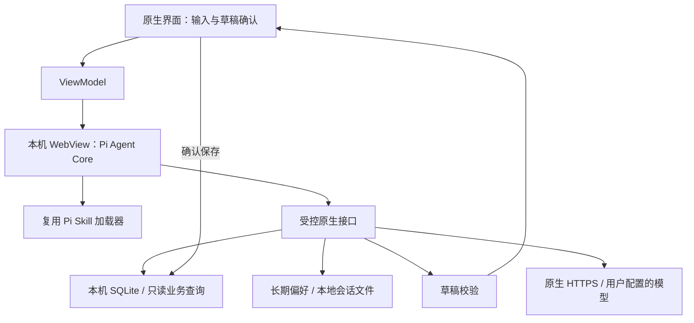

# 薄肌 Agent：选型与实现

2026-10-19。选择 **Pi Agent Core 1.3.0**，在 Android 的隔离 WebView 中本地运行。没有增加远程 Agent 服务或手机 Node 环境。原生 Kotlin 界面和 SQLite 保留。

| 候选 | 判断 |
| --- | --- |
| DeepSeek Harness | 功能完整，当前是 developer preview，Host 与插件依赖 Node。官方 Web Client 是 Host 的客户端，不是可直接内嵌手机的全部运行时。第一版移植成本较高。 |
| Pi | Core 可独立打包，提供成熟循环、工具校验、生命周期事件与取消。实际 browser bundle 约 320 KB；已通过 Android 36 模拟器执行验证。采用。 |
| DeepAgentsJS | 官方有浏览器入口、Skills/Memory middleware，功能更齐全；会增加 LangGraph/LangChain backend 适配。作为未来复杂工作流备选。 |
| Koog | 官方支持 Android，原生 Kotlin 集成可行；研究中是有竞争力的备选。本版选择已验证可打包运行的 Pi，保留宿主接口便于更换内核。 |

官方来源：[Pi Core](https://github.com/earendil-works/pi/blob/main/packages/agent/README.md)、[Pi SDK](https://github.com/earendil-works/pi/blob/main/packages/coding-agent/docs/sdk.md)、[DeepSeek Harness](https://github.com/deepseek-ai/deepseek-harness)、[Harness Web Client 架构](https://deepseek-harness.github.io/deepseek-harness/en/reference/subsystems/web-client)、[DeepAgentsJS](https://github.com/langchain-ai/deepagentsjs)、[Koog 平台](https://docs.koog.ai/why-koog/)。选型结论为结合源码与本项目测试的工程判断。

复用与适配的界线：

- npm 锁定 `@earendil-works/pi-agent-core`、`pi-ai` 1.3.0，直接复用循环、事件、工具执行和 TypeBox 校验，没有另写 Agent loop。
- Skill 发现、YAML 解析、元数据验证与提示目录使用上游 `skills.ts` 等源码，原样保留于 `agent-runtime/vendor/pi`；POSIX 虚拟文件系统由 Android 提供只读快照。
- 上游源码 commit：`482c1381a00d8d00bc81697e4a980c593db6803e`，MIT。bundle 同时包含第三方许可证、来源和文件散列清单。
- `PiAssistant.kt` 是 Android 宿主适配：把配置好的模型请求转换为原生 HTTPS，把工具连接到应用。密钥不进入 JS，WebView 不加载远程页面，也不能自行联网。
- Pi Core 自身不提供完整持久化记忆产品。这里实现的是平台存储适配：保存原生 Pi transcript、最多八轮且不超过 160 KB，按完整用户轮次裁剪；长期偏好由用户编辑。没有声称复用了完整 Pi CLI 会话系统或自动长期记忆引擎。

已提供五个工具：

| 工具 | 用途 |
| --- | --- |
| `read` | 只读已安装 Skill 的虚拟路径 |
| `search_records` | 按日期、领域、文字查实际记录，最多返回 50 条并注明截断 |
| `list_plans` | 查计划和目标 |
| `memory_read` | 读取用户维护的长期偏好 |
| `propose_draft` | 生成待确认记录、任务及明确要求的记忆，支持父子任务引用与分批暂存，不能直接保存 |

查询工具受近期记录授权控制，收支另需收支授权，`memory_read` 使用独立长期记忆授权。当前输入始终由用户发送，输入中的收支信息也会随输入交给模型。会话续接独立控制，恢复按角色、数据权限、连接和模型隔离；保存设置及修改／遗忘记忆会清空旧上下文。图片只在当前请求使用，不进入持久会话。修改真实记录必须经过草稿确认和数据库事务。

v0.2 只适配 DeepSeek 官方接口，默认地址预置，通过 `/models` 查询当前账号模型，再检查一次真实的两轮工具往返。适配思考模式 `reasoning_content` 回传及工具调用的非空值类型 `content`。无 Key 的自动测试使用供应商响应夹具，不代表通过了真实云端质量验收。参考：[官方接入说明](https://api-docs.deepseek.com/quick_start/agent_integrations/oh_my_pi/)、[思考模式](https://api-docs.deepseek.com/zh-cn/guides/thinking_mode/)。

每次运行最多八轮模型响应、24 次工具执行，总时限三分钟。停止时取消 Pi、清理待处理端口请求并断开原生 HTTP。失败不会自动重试写入。Tool 错误只返回经过处理的文字，不回显密钥或原始供应商错误。

Skill 导入支持有 name/description YAML 头部的单个 `.md`，每份 64 KB、最多 30 份；可查看和移除。没有文件夹附件、脚本执行或任意第三方 Tool 插件安装。新增原生工具需开发并声明 Schema，不以“支持 Skills”冒充任意代码执行能力。

当前模型协议为 Chat Completions + function tools，逐轮返回内容、显示工具状态；还未实现 token 流式输出、自动语义压缩、向量记忆、MCP、后台持久任务或多 Agent 调度。云端模型质量、时延和费用取决于用户连接，当前没有用户密钥，验收只覆盖脚本化供应商响应与真实手机运行时之间的链路。
