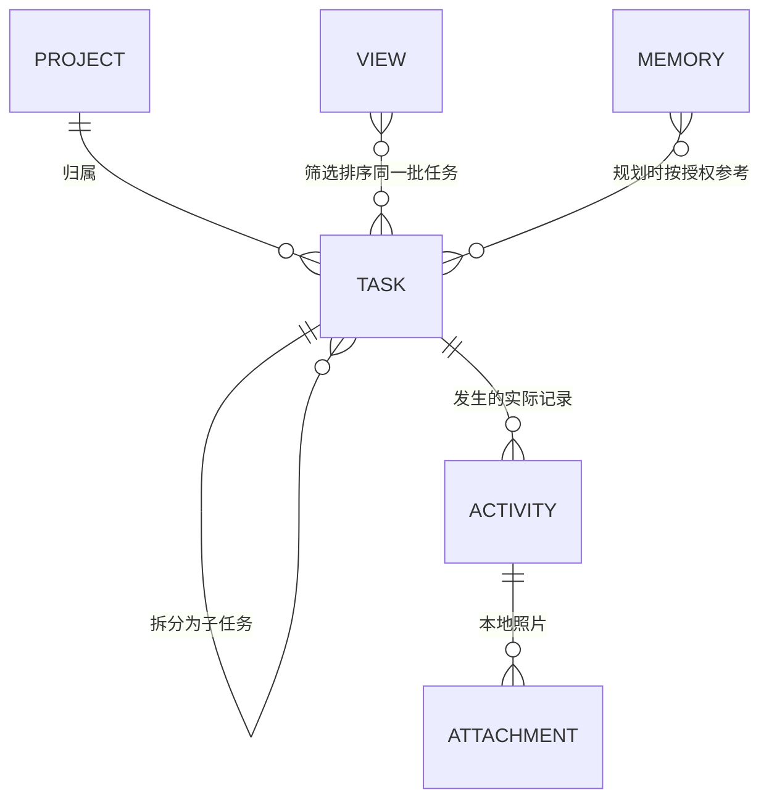

# 薄肌核心体验迭代：产品定义与验收

2026-10-19。用户已授权：先分析产品，再自行实施、开分支、提交和反复测试。分支 `codex/core-experience-v0.2`。

## 产品目标

用户通过一个 AI 入口，把安排、真实行动和长期偏好连起来；在日历和多维表格中管理同一批任务，在积累页回看真实记录及照片。

首要验收不是页面数量，而是三个场景能连续完成：

1. 文字＋照片记录训练，关联当天已有任务，查看附件和实际量。
2. 给出学习范围、日期与可用时间，生成每日计划，确认后排进日程并获得本地提醒。
3. 录入考试及复习任务，按截止时间、P0–P3、类型和状态整理，同一任务在两个视图同步。

## 借鉴飞书的机制

飞书官方说明：同一份记录可以采用表格、日历等视图；日期字段决定日历映射，字段可用于分组、筛选。薄肌采用这个数据与视图关系，保留手机端的短流程。

- [飞书：多维表格视图](https://www.feishu.cn/hc/zh-CN/articles/360049067931-使用多维表格视图)
- [飞书：日历视图](https://www.feishu.cn/hc/zh-CN/articles/980591272592-使用多维表格的日历视图)
- [飞书：分组和筛选](https://www.feishu.cn/hc/zh-CN/articles/360049067904-使用多维表格分组和筛选)

本轮从固定的有类型字段、保存视图、多条件排序和分组开始；自定义公式、权限体系和任意表结构不在这轮范围。

## 数据与视图

| 任务字段 | 产品口径 |
| --- | --- |
| 标题、类型、项目 | 训练、学习、收支、睡眠、项目、其他；项目是归类维度 |
| 安排日期／时间 | 任务出现在日历的时段；未安排时间时明确显示待安排 |
| 截止时间 | 与安排时间分开；空值排在有截止时间的任务后，不虚构 deadline |
| 优先级 | P0、P1、P2、P3；默认 P2，可由用户修改 |
| 状态 | 未开始、进行中、已完成、已跳过、已归档；归档保留事实和附件 |
| 父任务 | 学习目标或考试可关联多个复习／执行任务 |
| 预计／实际 | 预计时长来自计划，实际值由已确认记录汇总，不能互相覆盖 |
| 提醒 | 明确的日期、时间和提前量；权限关闭时显示未启用 |
| 附件 | 跟随实际记录保存，任务详情可回看，不把照片当完成证据 |

日程页提供“日历／多维表格”切换，共享任务来源。表格支持多条件排序、类型／状态／优先级分组、筛选、列显示和命名视图。排序同值时用稳定 ID 排序；空截止时间始终靠后。编辑同一 ID，不复制任务。

计划与实际记录继续分开存储。一个任务允许多条实际记录；记录明确标注是否完成该任务。部分训练记录使任务进行中，确认完成才切已完成。归档不删除实际记录。

## 场景 A：训练＋照片

“今天练胸练了七次”＋一张照片：

- 保留原话中的 7 次，不把次改成组，不补分钟、重量或动作数量；核对卡可改单位或继续澄清。
- 先查当天训练任务。唯一明确匹配时预选；多个候选时让用户选；没有任务时允许仅保存实际记录。
- 卡片展示日期、原话／项目、实际量、任务关联、照片及“是否完成本次任务”。
- 用户确认后保存实际记录和附件关联；重复确认不重复记账。任务、日历、表格和积累页可看到同一事实。
- 图片不会自动证明训练完成，也不会用于猜训练次数。当前输入照片只供本次授权模型识别。

## 场景 B：学习计划＋提醒

- 缺少学习内容、起止日期或可用时间时，先问缺失项。“N 天”须区分自然日与实际学习日。
- AI 查询已有安排和授权记忆，提出父任务及每日子任务。原有安排保留；重叠时段在核对页标出。
- 一次确认后，以稳定 ID 原子写入任务和日程，并按用户选定的时间设置提醒。
- 没有钟点的任务不擅自设置午夜提醒；通知权限未开或提醒已过期时显示实际状态。
- 本地提醒依赖 Android 通知权限及系统调度，展示权限状态，重启设备后重建未来提醒。

## 场景 C：考试与复习

- “3 号、5 号、8 号考试”缺少月份、年份和科目时先澄清，不按电脑当前月代猜。
- 考试保留自己的日期／deadline；复习任务通过父任务关联考试，调整复习不修改考试日期。
- 可保存“近期考试”“P0 优先”“按类型整理”等视图：截止时间升序 → 优先级升序 → 稳定 ID。
- 对已完成和已归档任务提供明确筛选；排序／分组不修改任务本身。

## 长期记忆

记忆与聊天上下文分别管理，提供独立入口。偏好、时间限制和长期目标逐条保存，标注来源与更新时间，支持编辑和遗忘。

- 用户明确说“记住……”时，提取候选并在确认卡保存；普通聊天内容不默认永久保存。
- 规划时按独立的记忆授权读取。切角色／模型和清空聊天不删长期记忆。
- 编辑／遗忘记忆后清理旧会话上下文，避免旧偏好从历史消息重新影响计划。
- 从旧版手写偏好迁移一条记忆，保留原文；新记忆纳入加密备份。

## 基础体验

- 设置改为独立页面；配置草稿离开页面、旋转、切后台后仍可恢复，密钥草稿使用现有 Keystore 加密。
- DeepSeek 官方入口：填 Key → 检测对话和工具链路 → 保存并使用。预设官方地址，模型列表／能力来自官方元数据和受验证默认值。
- 修复思考模式 `reasoning_content` 回传及工具调用兼容；测试覆盖该协议，不能把网络连通视为 Agent 可用。
- 统一键盘安全区域、焦点滚动和 Next/Done，固定保存／发送操作；长文本、小屏、大字体与手势返回进入验收。

## 最小迁移与测试

现有 SQLite 行为 JSON payload：新增字段使用兼容默认值读取旧数据，不重建或清空用户数据库。保留旧 ID、重复规则、事实和凭据；关联由统一校验和事务保证。备份升级需仍能读取旧版本。真实业务数据不用于测试。

| 阶段 | 产物与通过条件 |
| --- | --- |
| 1 产品口径 | 本文件、字段／状态／关联规则、用户场景验收 |
| 2 数据与 Agent | 兼容旧 payload；多条件排序稳定；照片与数量不丢；记忆可维护；DeepSeek 连续工具协议测试 |
| 3 原生界面与提醒 | 独立设置、草稿恢复、可操作多维表格、任务详情、通知权限与本地提醒 |
| 4 情境走查 | 子智能体在专用模拟器执行用户任务；发现问题→修复→重跑同一任务 |
| 5 交付 | 分阶段 Commit，构建 APK，保存测试／截图／散列及未验证边界 |

阻塞交付：丢输入、覆写既有安排、次数单位猜测、确认重复写入、附件丢失、两个视图不同步、切模型删除记忆、通知未启用却声称已提醒。

没有用户真实 Key 时，以官方协议契约和模拟供应商覆盖工具循环；真实云端质量和用户真机仍需明确记录，不能用模拟器走查冒充真人反馈。
