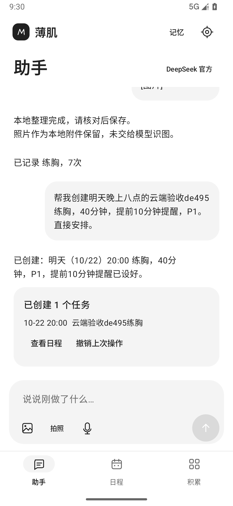
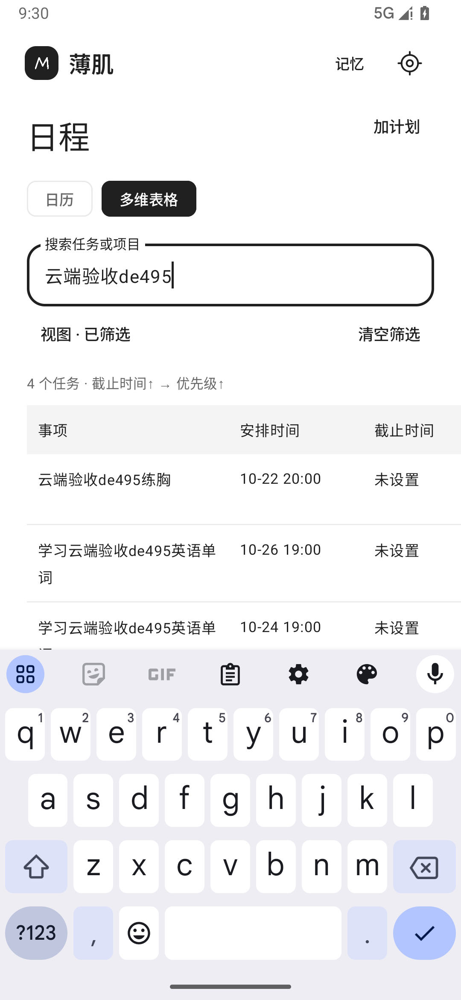

# v0.3 核心体验验收

本轮重点是「说一句话，任务直接进入日程」，并修复视图、配置、失败恢复和小屏操作。安装 [boji-debug.apk](../artifacts/boji-debug.apk)，版本 0.3.0，Android 8.0+，调试签名。实际运行验收为项目专用 Android 36 模拟器。

| 核心功能 | 当前行为 |
| --- | --- |
| Agent 直接安排 | 明确创建指令通过原生 `create_tasks` 校验后直接保存；连续改期使用 `update_tasks` 更新原 ID，显示真实结果和可恢复撤销，不再要求打开草稿页确认任务 |
| 日历／多维表格 | 共享同一份任务；截止时间、P0–P3、类型、状态、项目与父任务；多条件升降序、筛选、分组、显示列与保存／删除视图；日历也遵循所选排序 |
| 照片与实际记录 | 原话七次保留七次，继续纠正为八次时保留附件和任务关联；聊天内一键保存，可展开核对；不计时计数的明确完成保留未知值，不编造数量 |
| 学习与考试 | 明确日期的每日学习直接批量安排；父子关系、时刻、截止时间和提醒通过统一校验；缺月份年份先澄清，保留原有安排 |
| 简洁操作 | 三个主入口：助手／日程／积累；高级视图设置统一放在「视图」；日历默认本周，可展开整月；手动新建先填内容、日期、时间，更多字段折叠 |
| 失败恢复 | 失败或停止后保留输入，可重试；已提交的任务不会因后续模型失败而丢失；保存失败保留表单，成功后才关闭；工具查询读取最新数据库 |
| DeepSeek 配置 | 仅官方接口，预置地址；粘贴 Key，发现账号模型并检测两轮工具往返后启用；配置加密暂存，返回／旋转后恢复；读取权限显示当前生效配置 |
| 长期记忆与 Skill | 记忆可添加、修改、遗忘；明确「记住」生成一键确认草稿；独立读取授权；复用 Pi Skill 加载器，支持单份 Markdown 导入、查看与移除 |
| 本地提醒 | 明确时刻＋通知权限；可用时使用精确闹钟，否则采用系统非精确提醒；重启、时区与升级时重建，点击通知进入任务 |

沿用 Pi Agent Core 1.3.0，不重写 Agent 循环。任务写入由原生事务和确定性校验控制；实际记录和记忆保留一次确认。读取能力按当前授权暴露，原生侧再次检查。密钥留在原生侧，不进入 JS。

## 最终自动验证

2026-10-21，在最终应用与测试 APK 上复验：

| 检查 | 结果 |
| --- | --- |
| Agent JavaScript | 10/10，0 失败、0 跳过 |
| Kotlin JVM | 26/26，0 失败、0 跳过 |
| Android 36 常规 instrumentation | 43/43，219.036 秒 |
| 小屏大字体专项 | 1/1，19.121 秒；360×640 dp、字体 1.3；横屏 640×360 dp，任务行可见高度 62 dp |
| 真实 DeepSeek 手机内端到端 | 1 个综合测试通过，53.652 秒，包含下列九个检查点 |
| 构建与 Lint | 应用／测试 APK 构建成功；0 errors、8 warnings |

证据：[构建输出](../artifacts/build-verification.txt)、[常规 Android 输出](../artifacts/instrumentation-results.txt)、[小屏输出](../artifacts/small-screen-results.txt)、[真实 DeepSeek 输出](../artifacts/live-deepseek-results.txt)、[散列与版本清单](../artifacts/delivery-manifest.json)。专项用例包含常规场景的重复，不相加为不重复用例数量。

常规测试覆盖事务批量写入、父子批次、精确去重／字段冲突、并发修改拒绝、持久撤销与关联保护、读取授权、模型协议、真实 WebView Pi 循环、原始数量及照片关联、草稿纠正、无计量完成、旧数据兼容、配置／表单旋转恢复、失败后重试、保存失败保留输入、选中日期新建、创建结果跳转、保存／删除视图、加密备份及实际等待系统通知触发。

## 真实云端验收

使用用户授权的 Key，在 Android 应用内运行 Pi → 原生工具 → DeepSeek 官方 API → SQLite／界面，非宿主脚本替代工具结果：

1. 设置页输入 Key，获取官方模型并通过两轮工具连接检测。
2. 思考模式两轮工具往返通过。
3. 对话直接创建明晚 20:00、40 分钟、P1、提前十分钟提醒的训练任务；无待确认任务草稿。
4. 继续改到后天 21:00、P0，保留原 ID、时长和提醒；点击撤销恢复原安排。
5. 「三号考英语、五号考数学」缺月份年份，未写入任务，先澄清。
6. 连续三天 19:00 学习三十分钟的安排及提醒实际进入多维表格。
7. 合成测试图片通过真实图片请求发送，七次记录关联今天训练；继续改为八次保留照片，一次确认后任务已完成。
8. 明确长期记忆生成草稿，一次确认后持久化。
9. 明确完成但未计时计数的读书任务保留 minutes=0、count=0，关联正确任务并完成，没有捏造数据。

测试保留既有任务、恢复模型配置及加密草稿，删除本轮创建的数据和临时明文凭据；普通回归不调用付费模型。图片用例证明附件传输、文本数量纠正和关联保存，不证明从真实训练照片推断动作或次数的准确率。

| Agent 创建后的回执 | 真实数据的多维表格 |
| --- | --- |
|  |  |

[照片记录纠正后保存](../artifacts/screenshots/11-live-workout.png) · [小屏横屏任务行](../artifacts/screenshots/12-landscape-task-row.png) · [系统文件选择器导入 Skill 后的列表](../artifacts/screenshots/13-skill-import.png)。截图均为验收夹具，安装包不内置这些数据。

## 模拟用户与人工走查

独立子智能体实际操作专用模拟器，检查键盘、任务编辑、记忆修改／遗忘、设置权限和 Skill 文件选择器。确认小屏横屏表格被头部挤空，已压缩顶部／底栏、合并横屏视图入口；最终专项测试等待旋转和布局稳定，测量行高并人工查看截图，任务行完整可见。

主智能体补充实际导入 Markdown Skill：通过 Android DocumentsUI 选择测试文件，列表出现已导入 Skill，再点击移除，确认消失并删除自己的测试文件。没有把文件选择器打开就当作导入成功。

配置走查发现旧模型草稿中的权限与实际授权不一致。已修复为权限读取生效配置、模型字段恢复草稿；新增 UI 回归验证「草稿显示允许、实际未允许」时两个开关仍关闭，密钥草稿保留。

测试只清理自身夹具，不重置业务数据库；小屏脚本结束后恢复标准显示参数。模拟用户反馈属于代理走查，不作为实体手机验收或真实用户访谈。

## 试用

1. 设置 → 模型：粘贴自己的 DeepSeek Key，点击检测并启用；在「使用范围」开启希望助手读取的数据。
2. 说「明晚八点练胸四十分钟，P1，提前十分钟提醒，直接安排」，检查创建回执和「查看日程」，再说「改到后天九点」。
3. 「日程」切换日历／多维表格；在「视图」选择截止时间、优先级、类型、状态等排序与筛选，保存常用视图。
4. 拍照并说「今天练胸练了七次，已经完成」，继续说「改成八次」，检查关联与照片后在聊天中保存。
5. 说「记住：周二晚上不能学习」，保存后进入顶部「记忆」编辑或遗忘。
6. 设置中开启通知；准时提醒可授权「闹钟和提醒」。保存含明确钟点的任务，检查实际通知。卸载前导出加密备份并保存密码。

## 验收边界

已实际调用 DeepSeek 官方 API；未做用户实体手机验收。Android 8.0 是最低构建要求，运行证据仅覆盖 Android 36 模拟器。真机键盘、后台省电、系统语音和通知准时性仍需对应手机验证。模型回复与耗时会波动，本次综合用例不代表全部自然语言输入均正确。

多维表格使用固定任务字段，未实现完整飞书平台、自定义字段类型和跨表公式。长期记忆由用户维护或明确请求保存；没有后台自动提取、向量检索。健康平台导入、跨设备同步、MCP、任意 Skill 脚本、多 Agent 并发、token 流式输出不在本轮交付范围。

```powershell
powershell -ExecutionPolicy Bypass -File scripts\build.ps1 -Verify
powershell -ExecutionPolicy Bypass -File scripts\test-emulator.ps1 -Serial emulator-5554
powershell -ExecutionPolicy Bypass -File scripts\test-small-screen.ps1 -Serial emulator-5554
# 真实云端验收另需当前进程 BOJI_DEEPSEEK_KEY
powershell -ExecutionPolicy Bypass -File scripts\test-live-deepseek.ps1 -Serial emulator-5554
```
