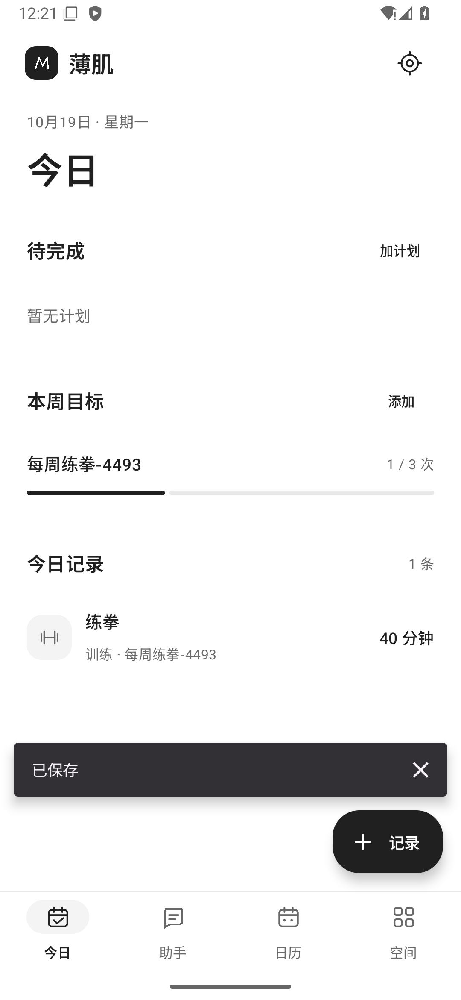
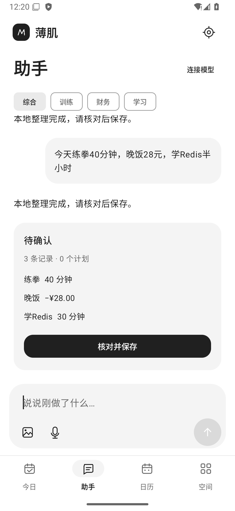
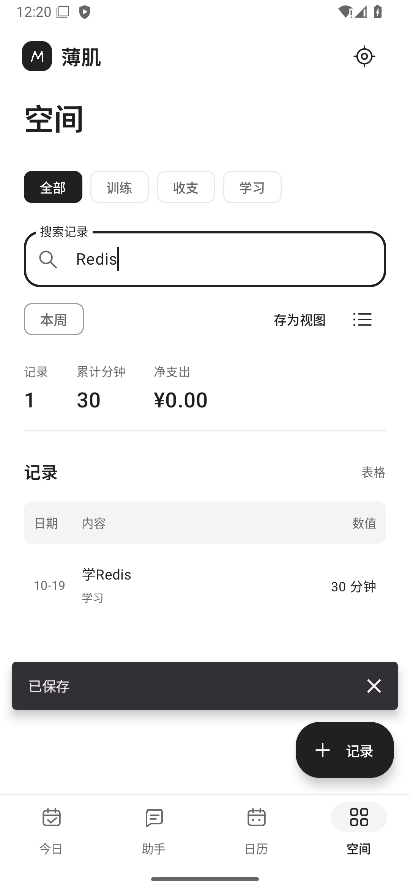
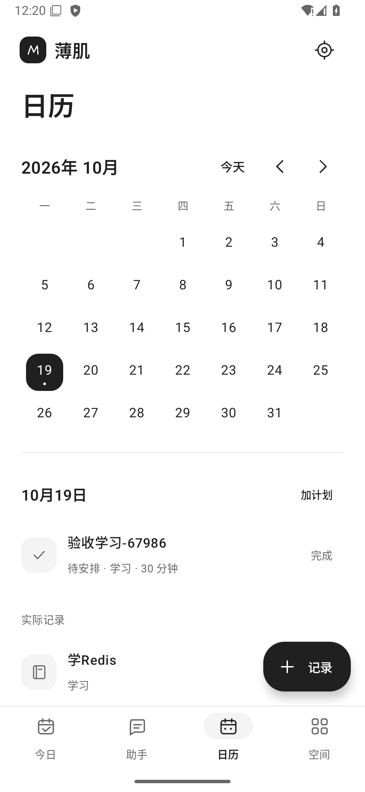

# 首版验收记录

2026-10-19。本地 Android 调试包已生成，未发布应用商店。实际设备为本项目专用 Android 36 模拟器，用户真机尚未验收。

安装入口：[boji-debug.apk](../artifacts/boji-debug.apk)，Android 8.0+。APK 不含示例数据库、模型密钥或预置用户记录。调试签名仅供本地试用。

| 功能 | 已实现 |
| --- | --- |
| 今日 | 手动记录训练/收支/学习，加计划、完成计划、每周次数或分钟目标 |
| 日历 | 按月切日、查看计划和实际记录、跳过/改期、固定星期重复 |
| 空间 | 关键词/领域/本周筛选，列表/表格、保存视图、净支出与累计分钟 |
| 助手 | Pi Agent Core 1.3.0、五个受控工具、内置/导入 Skill、长期偏好、本地会话恢复、停止 |
| 输入 | 文字、系统语音、图片选取；图片仅发给当前支持图片的云模型 |
| 数据 | SQLite 原子保存、草稿确认及幂等、Keystore 保护密钥、加密备份与合并、CSV |

一次记录直接更新关联目标进度，完成计划会补真实记录；删除真实记录后，计划回到未完成。固定重复规则保存于本机，打开时补齐未来八周；编辑和删除目前只作用于本次。

验证结果：

| 检查 | 结果与范围 |
| --- | --- |
| Agent JS | 7/7：真实 Pi 循环、Skill 读取、工具参数拒绝、越界路径/未知工具、循环上限、取消、会话恢复 |
| Kotlin JVM | 16/16：本地输入/草稿协议、金额与进度规则、备份密码与篡改校验 |
| Android instrumentation | 17/17：10 项 SQLite/备份/重复规则测试，1 项加密备份与图片恢复，2 项界面完整流程，4 项真实 WebView Pi 集成 |
| Android 构建 | assembleDebug、assembleDebugAndroidTest 成功 |
| Android Lint | 0 errors，4 warnings；主要为依赖更新与 Modifier helper 建议 |
| 视觉检查 | 四张真实模拟器截图已检查，修正了残留紫色及动画/键盘截图时机 |

Pi 集成测试使用脚本化供应商响应，实际运行 APK 内的 Pi bundle、Android WebView、原生端口、草稿校验和文件持久化。覆盖了 Skill → 数据查询 → 偏好读取 → 草稿 → 确认保存、重复确认不重复入库、重启恢复、授权变更隔离以及取消后继续请求。

当前没有用户模型密钥，所以没有执行真实付费云模型请求，也没有宣称规划质量、识图准确率、流式响应、云端费用或用户手机兼容性通过。语音识别依赖设备服务。Android 8.0 仅为构建最低版本，实际运行验收只完成于 Android 36；建议保持系统 WebView 更新。

证据：[构建及 JS 检查输出](../artifacts/build-verification.txt)、[17 项 Android 测试输出](../artifacts/instrumentation-results.txt)、[交付散列](../artifacts/delivery-manifest.json)。详细 JVM XML 与 lint 报告位于 `app/build/test-results/testDebugUnitTest/`、`app/build/reports/`。

实际界面（含验收时临时创建的数据，首次安装为空）：

| 今日 | 助手草稿 |
| --- | --- |
|  |  |

| 表格 | 日历 |
| --- | --- |
|  |  |

本机复现：

```powershell
powershell -ExecutionPolicy Bypass -File scripts\build.ps1 -Verify
powershell -ExecutionPolicy Bypass -File scripts\test-emulator.ps1 -Serial emulator-5554
```

手机试用：

1. 安装 APK，进入“助手”，发送 `今天练拳40分钟，晚饭28元，学Redis半小时`。
2. 应看到三条待确认草稿，核对后保存，切换“空间”查看真实记录。
3. 在“今日”添加目标，记录训练时关联目标；在“日历”添加并完成计划，检查进度。
4. 在设置填写自己的模型地址、名称和 Key；需支持工具调用。开启所需数据授权，尝试“根据本周记录安排明天的训练和学习”。
5. 如需自定义 Skill，可导入有 YAML name/description 的 `.md`，在设置中查看或移除。

尚未实现的范围：后台通知、健康平台自动导入、跨设备同步、任意自定义表结构；Agent 的 token 流式输出、自动长期记忆提取、MCP、后台工作流、多 Agent 并发及 Skill 脚本执行。详情见 [Agent 实现说明](./agent-runtime-evaluation.md)。
