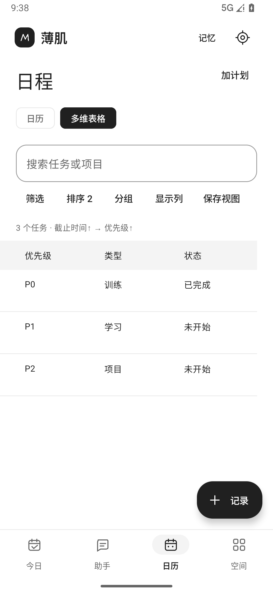
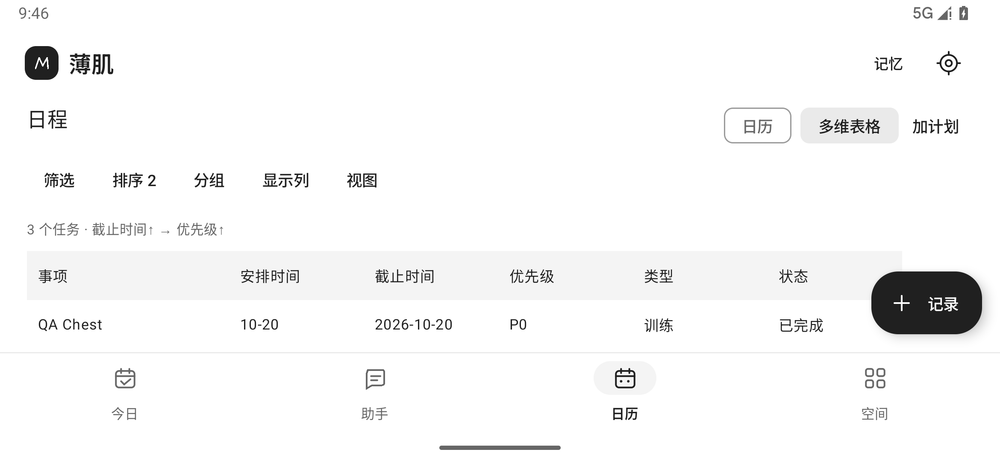

# v0.2 核心体验验收

本轮围绕“说一句话，形成记录或日程，看到长期积累”迭代。安装 [boji-debug.apk](../artifacts/boji-debug.apk)，Android 8.0+，调试签名。实际运行设备为项目专用 Android 36 模拟器。

| 核心功能 | 当前行为 |
| --- | --- |
| 同一份任务，两种视图 | 日历／多维表格共享任务 ID；截止时间、P0–P3、类型、状态、项目与父任务；多条件升降序、筛选、分组、显示列及保存视图 |
| 一句话＋照片 | “今天练胸练了七次”保留为 7 次，不猜成 7 组或添加时长；唯一明确候选关联当天任务，照片与原话随记录保留；歧义由用户选择 |
| 进展与完成 | 一个任务可以有多条实际记录；部分记录进入“进行中”，明确完成后进入“已完成”；归档和删除关系经统一校验 |
| 学习／考试安排 | Agent 可提出考试与每日复习任务、父子关系、优先级、截止时间及提醒；确认后写入日程；保留原有安排。缺月份年份、时段时需要澄清 |
| 本地提醒 | 明确时刻＋通知权限，优先使用获准的精确闹钟，否则采用系统非精确提醒；重启、时区变化、版本升级时重建；点击通知打开任务 |
| 长期记忆 | 独立列表，可添加、修改、遗忘；明确“记住”生成确认草稿；独立读取授权，修改或遗忘后清空旧对话上下文；纳入加密备份 |
| DeepSeek 官方配置 | 预置接口，输入 Key，获取模型并检测两轮工具往返后启用；返回重进保留加密草稿，权限／角色修改保留待填配置 |
| 输入体验 | 独立设置页、固定底部操作、焦点随键盘滚动；助手支持键盘发送；任务、记录、记忆及草稿编辑保留旋转前内容 |

复用 Pi Agent Core 1.3.0 与上游 Skill 加载器，提供受控工具、可停止的工具循环和本地会话恢复。正式记录、任务和记忆仍经用户确认及 SQLite 事务写入。模型密钥保留在原生侧；数据读取由独立授权控制。

## 自动验证

2026-10-20 最终复验通过：

| 检查 | 结果 |
| --- | --- |
| Agent JavaScript | 8/8 |
| Kotlin JVM | 25/25，0 失败、0 跳过 |
| Android 36 instrumentation | 29/29 |
| 构建 | 应用与测试 APK 均成功生成 |
| Android Lint | 0 errors、8 warnings；依赖更新及代码风格建议 |

证据：[构建输出](../artifacts/build-verification.txt)、[原生测试输出](../artifacts/instrumentation-results.txt) 与 [交付散列](../artifacts/delivery-manifest.json)。

测试覆盖：原话数量与单位、关联歧义、稳定多条件排序、父子考试计划、DeepSeek 思考字段和空内容兼容、旧 JSON 迁移、多条记录与部分进展、记忆和视图备份、凭据草稿加密、配置／表单／草稿旋转恢复、真实 WebView Pi 工具循环、超过 1 MB 的多模态 JSON 请求传输、照片方向、核对页照片与完成状态预览、横屏表格及日历切换，以及实际等待系统通知触发。

Pi 和 DeepSeek 协议测试使用脚本化供应商响应，实际执行应用内 Pi bundle、WebView、原生工具、校验和存储；未使用真实付费模型 Key。考试规划集成测试生成一场考试及十四天复习，确认前不写入，确认后保留已有安排。

## 模拟用户走查

独立子智能体在专用模拟器中操作 UI。实测通过：

- 设置下滑不关闭；思考选项暂存经旋转、返回重进保留。记忆新增、修改、编辑中旋转、确认遗忘正常。
- QA 草稿从 7 次改为 8 次，保持键盘打开时一次点击保存；旋转、返回重进仍为 8 次，正式确认后同一任务显示已完成及实际 8 次。
- 截止时间升降序、多条件排序顺序、学习类型筛选、状态分组、显示列、保存及重新应用视图生效。
- 360×640 dp、字体 1.3 倍时，API Key 输入框与检测按钮位于键盘上方，均可操作。未修改 Key、未触发云端检测。
- 实际发现横屏头部占满内容区，已压缩横屏头部、移动搜索和视图入口；复测任务行可见，横纵滚动及保存视图可用。分组时可视高度仍紧，可通过纵向滚动查看。

自动化最初在输入法弹起后出现点击未命中的不稳定现象；测试增加动画稳定等待，并同时验证键盘发送与真实发送按钮。手动走查没有复现草稿保存逻辑丢失。手动夹具仅创建及清理固定 QA 记录、任务、视图，未重置数据库或修改凭据；显示参数已恢复。自动化场景与模拟用户反馈分别记录，不视为真实用户访谈。

| 多维表格实际量 | 横屏修复后 |
| --- | --- |
|  |  |

[小屏大字体与键盘](../artifacts/screenshots/07-settings-keyboard.png) · [独立记忆](../artifacts/screenshots/08-memory.png)。截图使用 QA 夹具，首次安装没有这些测试数据。

## 试用步骤

1. 助手发送 `今天练胸练了七次`，可先拍照或选图；打开草稿核对数量、关联任务和附件，再确认。
2. 日历中添加任务，切换“多维表格”，设置排序、筛选和分组；点击一行编辑任务。
3. 对助手说 `记住：周二晚上不能学习`，确认后进入顶部“记忆”修改或遗忘。
4. 设置中输入自己的 DeepSeek Key，检测后启用，开启需要的数据读取权限。试说“十五天后上午九点考英语，每晚七点复习半小时，提前十分钟提醒”。
5. 设置中开启系统通知；有准时要求时允许“闹钟和提醒”。保存带明确时间的任务，检查通知。手机系统和省电策略可能延后提醒。
6. 使用设置中的加密备份；卸载前导出并妥善保存密码。

## 交付边界

没有真实 DeepSeek Key 或用户真机，因此云端规划质量、识图准确率、实际费用和真机键盘／省电兼容性尚未验收。模型未确认支持图片时，照片只作本地附件，界面明确说明。语音依赖手机系统服务。最低支持 Android 8.0 是构建要求，当前实际运行验证仅覆盖 Android 36。

多维表格使用固定任务字段，未实现完整飞书平台、自定义字段类型或跨表公式。健康平台自动导入、跨设备同步、后台自动记忆提取、向量检索、MCP、任意 Skill 脚本及多 Agent 并发不在本轮范围。

```powershell
powershell -ExecutionPolicy Bypass -File scripts\build.ps1 -Verify
powershell -ExecutionPolicy Bypass -File scripts\test-emulator.ps1 -Serial emulator-5554
```
