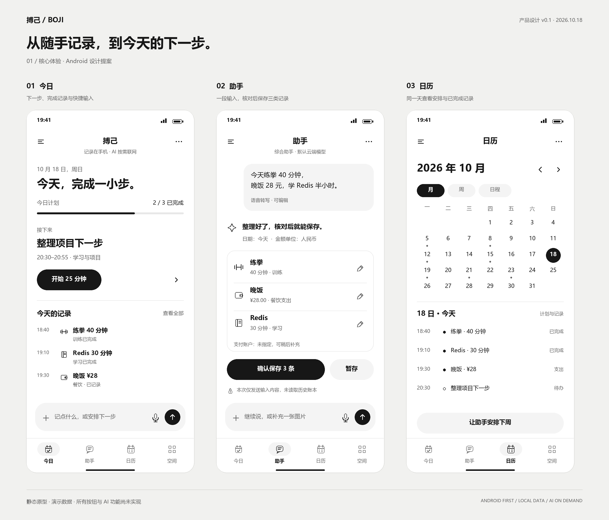
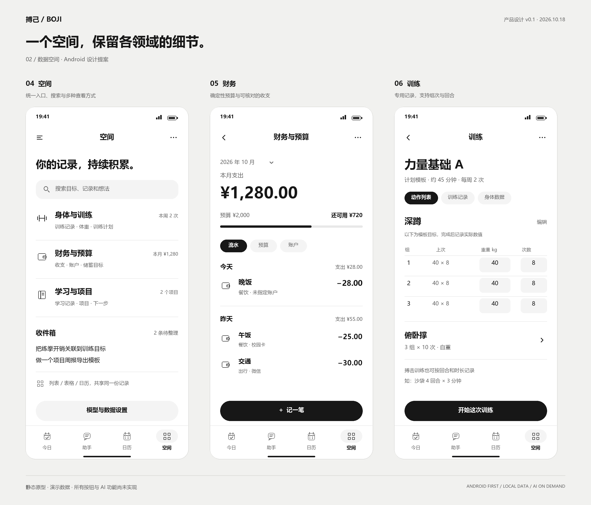
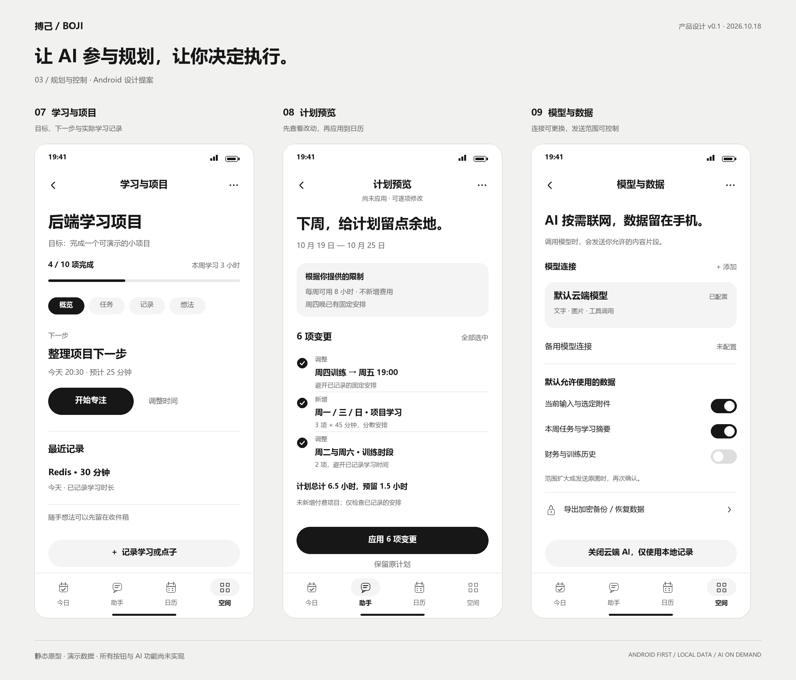
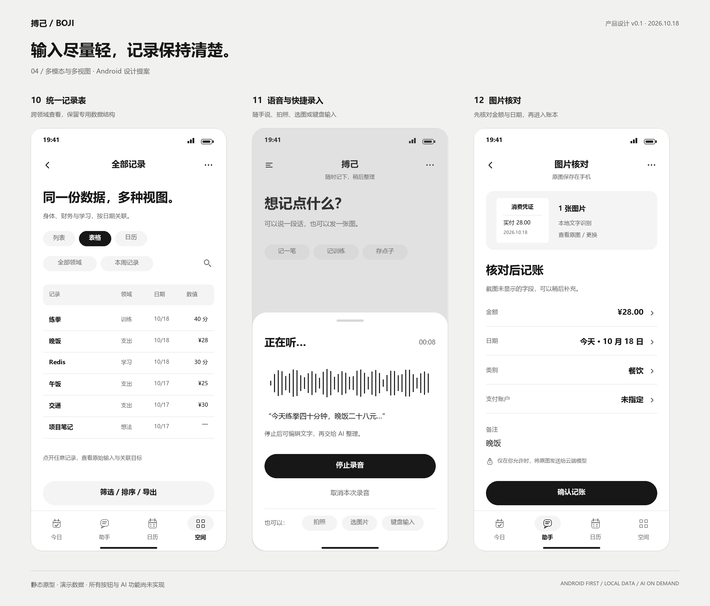

# 搏己：产品评估与原型提案 v0.1

> 设计历史：用户已将名称订正为「薄肌」并认可手机方向。后续方案见 [v0.2](../product-design-v0.2/README.md)，本版图片保留原样。

评审日期：2026-10-18。状态：**方案待确认，尚未开始应用开发**。

“搏己 / Boji”仅为方便讨论的工作名，未决定品牌，也未做商标与应用商店重名核查。

用户已确认：**Android 优先；数据保存在手机；允许按需调用云端 AI**。

## 先看什么

1. [产品方案与评估](./product-proposal.md)：定位、竞品、首版范围、AI 与本地数据方案、验证和投入。
2. [交互与验收说明](./interaction-spec.md)：十二个页面、两条核心路径、失败状态与后续验收标准。
3. [调研来源](./research-sources.md)：官方资料能证明什么，以及哪些结论仍是产品假设。

## 原型图

图片是高保真静态设计稿，所有数字为虚构演示数据。按钮、语音、记账和 AI 都未实现。

### 核心工作流

### 数据空间

### 学习、计划与模型

### 多模态与多视图

共四张画板、十二个页面。单页高清图均在 `prototypes/` 下，编号对应交互说明。

## 本轮交付边界

只新增设计文档与图片；没有创建应用工程、安装项目依赖、接入真实 AI、采集用户数据或部署服务。图中“已保存”等字样用于展示预期交互状态。

推荐评审顺序：**先确认定位与首页 → 再确认首版范围 → 最后决定技术栈并授权开发**。本提案中的技术选型、预算与排期均为建议。
