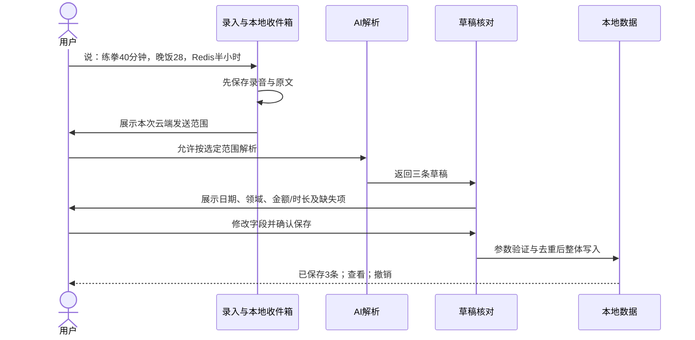

# 原型页面、交互路径与验收规则

2026-10-18 · v0.1。所有页面为静态视觉稿，演示数字不是用户真实数据。

## 1. 页面清单

| 编号 | 文件 | 页面 | 主要交互意图 |
| --- | --- | --- | --- |
| 01 | `prototypes/01-today.png` | 今日 | 查看下一步、时间线、待处理草稿；固定入口快速记录 |
| 02 | `prototypes/02-assistant.png` | 助手 | 一段输入生成三类草稿，逐项编辑，整体确认保存 |
| 03 | `prototypes/03-calendar.png` | 日历 | 月历选日期、当日议程、计划与完成状态、计划预览入口 |
| 04 | `prototypes/04-spaces.png` | 空间 | 三个领域入口、统一搜索、收件箱、固定字段表格 |
| 05 | `prototypes/05-finance.png` | 财务 | 月预算、支出、交易列表，快捷表单录入 |
| 06 | `prototypes/06-workout.png` | 训练 | 模板详情、力量组次示例、训练记录；非模型生成的实时纠错 |
| 07 | `prototypes/07-learning.png` | 学习与项目 | 阶段目标、下一步、想法与学习记录 |
| 08 | `prototypes/08-plan-preview.png` | 计划预览 | 检查限制、查看新增/调整、选择应用、保留原计划 |
| 09 | `prototypes/09-ai-settings.png` | 模型与数据 | 模型连接、云端数据范围、数据导出、只用本地模式 |
| 10 | `prototypes/10-unified-table.png` | 统一记录表 | 跨领域表格、筛选、排序与导出；金额与时长不跨单位相加 |
| 11 | `prototypes/11-voice-capture.png` | 语音与快捷录入 | 可停止和取消的录音；拍照、选图和键盘入口 |
| 12 | `prototypes/12-image-review.png` | 图片核对 | 原图与 OCR 建议对照，编辑金额、日期、类别后入账 |

主工作区采用统一顶栏、24dp 边距、16sp 正文、黑色主按钮、浅灰输入框、四项底部导航。子详情页使用返回，不增加第五个导航入口。

## 2. 核心路径 A：一次输入，多类记录

一次性开启云端规则后，不要每句话重新弹隐私对话框；保留可见范围标识。范围扩大、首次原图外发、变更供应商时重新确认。

02 展示的是“待确认”时刻；01/03/05/07 展示同一批记录已经保存后的时刻，不能理解为待确认草稿已经写入正式账本。批量确认前允许勾选、编辑或丢弃其中一条；原型采用“保存 3 条”表现当前全选状态。样例中的具体时间是示范数据中另行填写的值，不能从只含“今天”的语音中推断出来。

语音按下/点击录制均有可见状态、停止和取消；权限请求发生在第一次使用该能力时。识别未完成可以退出，原始输入留在收件箱。截图通过主动分享、拍照或图片选择，不承诺持续监控屏幕、读取所有通知或读取其他应用数据库。

金额“28”在用户默认人民币、上下文明确为晚饭消费时可建议 ¥28；“二十八还是三十八”或截图模糊时必须待补。缺失支付账户可存为未指定，账户余额仅统计已归属的交易。

## 3. 核心路径 B：AI 跨域排周计划

1. 用户明确提出目标，选择本次允许使用的领域。
2. 读取目标、固定安排、已知空闲时段与预算摘要；缺少必要信息先提问。
3. 生成草案，只使用可解释的已知约束；时间冲突和预算由本地程序计算。
4. 进入 08：显示每条修改和理由，允许取消部分项目；默认不写入计划。
5. “应用 6 项变更”只写入当前勾选集合；应用时再次检查版本与冲突。
6. 返回日历，提供本批次撤销。用户后来又编辑的项目，不被无提示覆盖式撤销；改为展示冲突与恢复选择。

08 演示用户已提供“每周可安排 8 小时、不新增费用、周四晚固定有事”，AI 建议把周四训练移到周五，加 3 项学习并调整另 2 项安排，共 6 项变更；计划总时长 6.5 小时。此数值仅为展示，不代表真实用户约束。

## 4. 今日、日历和表格的行为

- 今日只显示当日下一步、计划完成数、已确认事实与未处理输入入口，避免财务、身体、学习各放一排仪表盘。
- 完成任务后，必要的训练时长/学习时长可补填；打卡次数与专业记录指标分开，不自动生成虚构事实。
- 未完成任务可保留、跳过或改期。习惯断签不清空历史，不给惩罚性措辞。
- 选日历日期查看当日日程；切换计划/记录过滤器，标识“完成、待办、支出”。无确切时刻的记录放当日单独区域，不编造时间。
- 账单默认不占据未来计划时间块；用户手动添加的还款/缴费提醒才是计划。
- 空间默认列表。切到表格展示固定字段、筛选与排序；单条点开底部详情，较宽表格允许水平查看。
- 今日进度按当日计划任务统计：样例是 3 项计划完成 2 项；晚饭账单不是第四个任务。

## 5. 状态设计

| 状态 | 页面反馈 | 数据规则 |
| --- | --- | --- |
| 没有数据 | 可用的一条示例、手动记录/设置首个目标 | 不强制先配置 AI |
| 完全离线 | “记录已保存在手机，联网后可解析” | 队列持久化，联网外发仍遵循既有授权 |
| 正在识别/生成 | 进度、取消，明确当前处理的附件 | 防重复提交，取消保留原输入 |
| 字段有歧义 | 对应字段标“待补充”并聚焦修正 | 必填项未补齐不进正式账本 |
| 模型超时/额度不足 | 重试、改用已授权备用连接、手工填写 | 不丢附件，不重复写记录 |
| 模型不支持图片/工具 | 说明能力限制，提供文字/OCR路径 | 不伪造成功工具结果 |
| 相似账单重复 | 对照原记录、仍然新增/取消 | 不凭相似文本自动删除 |
| 权限被拒绝 | 文字输入、手选图片、设置引导 | 不循环请求权限 |
| 计划冲突 | 标出具体重叠或预算缺口 | 提示修改，用户明确选择后再写 |
| 云端关闭 | 本地记录可用，AI依赖操作显示暂停 | 无隐式联网回退 |
| 存储不足/写入失败 | “未保存”，可复制文字/清理附件后重试 | 不展示成功状态，不丢原输入 |
| 数据删除/备份 | 删除范围、附件关系、导出与恢复结果可见 | 日志不保留完整敏感原文副本，恢复核对数量与关系 |

## 6. 对话工具结果

AI 结果必须区分：建议、待确认、已保存、执行失败。只有数据库提交成功后才能显示“已记录”。查询回答给出可点开的本地记录依据；没有找到时说明范围与缺失，不捏造周/月表现。

涉及原图发送时显示实际目标供应商；用户看得到将发送的是图片、转写文本还是汇总数字。模型连接测试只发无个人数据的测试内容。

## 7. 视觉细则

- 基底：白 #FFFFFF、文字 #171717、次文字 #646464、浅灰面 #F4F4F4、分隔 #E8E8E8。
- 原型以系统无衬线为方向；Windows 出图使用微软雅黑，Android 实现跟随系统字体。未采用检索工具推荐但不适合此场景的装饰性衬线组合。
- 主按钮黑底白字；状态尽量用文字和图标，而非仅靠颜色。
- 圆角：输入框 24dp，操作面板 16–20dp；普通内容用列表分隔线，卡片只用于可编辑草稿、计划预览等独立操作。
- 正文建议 16sp，次信息 12–14sp，标题 24–28sp；触控区 48dp。图中的静态图标边界不等于最终点击区。
- 默认浅色，深色跟随系统属于后续实现与实机验收项；本次没有交付深色稿，也没有宣称已通过深色对比度或大字体测试。

## 8. 后续开发验收清单

当前全为拟定验收，尚未执行：

- 飞行模式下三类记录与任务可新建、编辑、查询，强制重启后保留。
- “练拳40分钟，晚饭28，Redis半小时”正确拆分；保存和重试不重复；撤销处理完整关联。
- 收入、支出、转账、退款计算明确；月预算、跨月日期、未指定账户不混算。
- 原始数据发生变化时计划预览失效并重新核对；批量应用部分失败不能留下隐蔽中间状态。
- 关闭云端及排除财务后，拦截日志/网络检查确认不会发送被排除内容；日志不输出密钥和完整流水。
- 密钥不硬编码进 APK；数据库、附件、导出文件的保护按最终方案验证。
- 加密备份能在干净安装中恢复目标、任务、记录、附件和关联；错误密码失败且不破坏现有数据。
- Android 真机验证语音、OCR、分享接收、中文、弱网、权限拒绝与系统杀进程；至少覆盖用户主机型，再决定第二厂商。
- 360dp 与 412dp 宽度、系统大字体、屏幕阅读、键盘弹出、返回操作、减少动画与暗色模式验收。

## 9. 设计稿使用边界

四张画板共十二页，使用统一的 390 × 844 逻辑画布，输出双倍分辨率单页 PNG。没有交互原型、真实系统通知、可运行 Agent 或 APK。未来交互评审若需要可点击串联稿，应先得到用户对本方案的方向反馈，再决定采用原型工具还是进入工程。

11/12 展示语音与图片两条独立输入路径，12 是图片可以被本地 OCR 正确识别的演示状态，并不表明所有目标手机已经具备此能力。统一表格中的空值不会自动填零；缺少确定字段继续保留在草稿。十二页均经过静态图面查看，运行时交互、大字体、深色和设备能力仍待后续实现验证。
