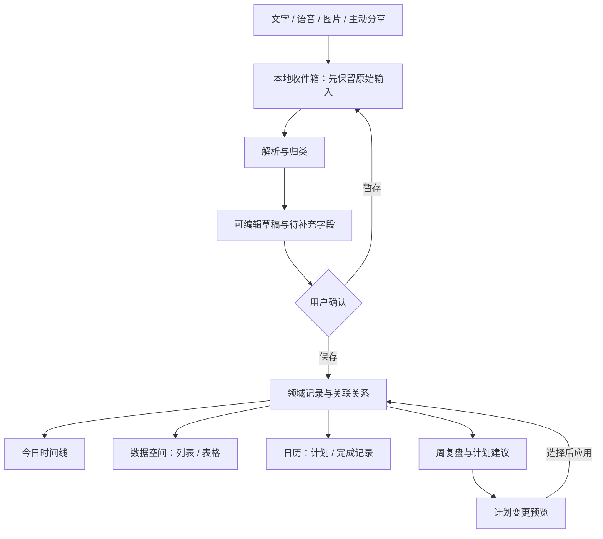
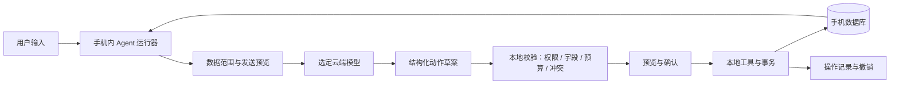
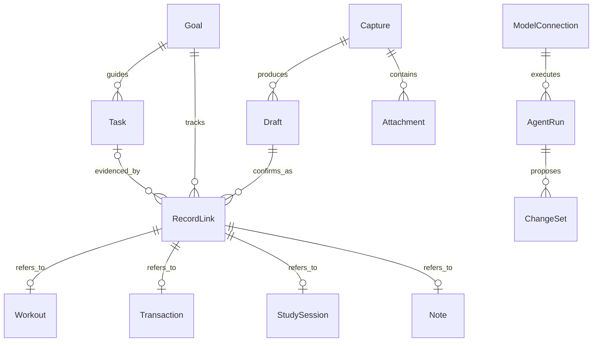

# 搏己：产品方案与可行性评估

2026-10-18 · v0.1 · 设计提案，等待用户确认。

## 1. 我的判断

**值得做一个收敛的个人自用版，再验证小群体需求；目前还不足以直接投入“全能个人助手”的完整商业版。**

用户已确认 Android 优先、记录保存在手机、AI 可按需联网。建议定位为：

> 一个本地优先的个人行动助手：随手记录训练、收支和学习，把目标变成当天做得完的安排。

最值得验证的价值有三项：

1. 一次文字、语音或图片输入，形成多个领域的可编辑记录。
2. 安排目标时，综合已经记录的时间、预算与训练安排，指出冲突并给出可执行草案。
3. 数据是用户可查看、导出和恢复的长期资产；换模型后仍能继续管理。

这不是用户调研结论，是待验证的产品假设。只有在录入明显更省事、计划确实被采用时，三个领域放在一起才有价值。

“搏己”只是工作名。传播可以借用熟悉的话题，长期定位应覆盖训练、钱与成长，不依赖梗、不限定性别，也不以“自律失败”给用户压力。

## 2. 给谁用，先解决什么

首批目标用户：已经开始运动、会简单记账、同时在学习或做项目的大学生与初入职场者。先从开发者自己和 5–8 位符合条件的体验者开始，暂不面向专业运动员、复杂资产管理者或团队管理。

| 用户时刻 | 当下要完成的事 | 拟议体验 |
| --- | --- | --- |
| 刚练完，手上不方便操作 | 留下训练内容和感受 | 说一句，核对训练名称、时长或组次即可 |
| 付款之后 | 记清金额与类别 | 金额快捷输入、主动分享截图或拍票据，确认后入账 |
| 突然有一个点子 | 先保存，稍后整理 | 不要求先建项目，直接进收件箱 |
| 晚上回顾 | 看清今天实际做了什么 | 同一天时间线呈现完成记录与剩余事项 |
| 周末排下周 | 目标别挤满可用时间 | 输入限制条件，AI 提议，检查冲突，用户选择后应用 |

新用户首次使用：无需注册即可记录 → 选择一个当前关注领域 → 保存第一条记录 → 再按需配置 AI 与其他领域。避免首次打开填写财务、身体、目标的长问卷。

## 3. 竞品说明了什么

| 参照产品 | 官方已经提供的能力 | 我们应该学的东西 |
| --- | --- | --- |
| [Hevy](https://www.hevyapp.com/features/) | 专门的训练记录、计划、组次、历史数据 | 训练场景保留专用快速表单 |
| [TickTick](https://ticktick.com/?language=en_us) | 任务、习惯、日历、专注 | 今日视图和日历共享执行状态 |
| [Anytype](https://anytype.io/) | 本地优先、移动端、对象关系与数据库视图 | 数据所有权和关联视图 |
| [Actual Budget](https://actualbudget.org/) | 本地优先、交易、预算与报表 | 预算计算准确、账户与交易关系清晰 |
| [Lark Base](https://www.larksuite.com/hc/en-US/articles/359626216875-use-calendar-views-in-base) | 同一记录形成表格和日历视图 | 同一份数据，多种查看方式 |
| [Notion AI](https://www.notion.com/help/ai-safety) | 工作区内对话、搜索与写作 | AI 与真实数据空间结合 |

不能因为这些产品的主要定位不同，就声称没有直接竞争。“ChatGPT + 日历 + 记账应用”的组合也是替代方案。真正的比较题是：**用搏己能否少开应用、少填字段，并减少计划与实际记录之间的脱节？**

产品最难的部分是记录纠错、长期数据可信度、手机使用摩擦与持续使用意愿；单次生成一份计划通常更容易演示。

## 4. 产品的统一方式

三个领域共享“目标、时间、记录、来源、附件”，但各自保留领域结构。

关键区别要在数据中表达：

- **目标**：每周训练三次、完成某个项目、每月储蓄一定金额。
- **计划**：未来某天准备做什么；有计划不等于完成。
- **事实**：真实训练、实际学习时长、已经发生的收支。
- **想法**：暂未安排的内容；默认不制造任务，也不占用日历。

同一段语音可以产生多个子记录，以原始输入关联。计划完成时关联事实记录，避免在日历里叠成两份同一活动。

### 三者打通的真实例子

用户说：“今天练拳 40 分钟，晚饭 28 元，学 Redis 半小时。”

草稿显示训练 40 分钟、餐饮支出 ¥28、学习 Redis 30 分钟。训练明细没有提到组次、强度、热量，就不自行补齐。付款账户没说时允许记为“未指定”；不把未知账户余额显示成真实值。

再说：“下周只能抽四个晚上，想练三次，还要推进项目，不想额外花钱。”

系统应先展示已知固定安排与可用时间；缺少每晚时长时先问。只利用用户记录或明确提供的约束，检查练拳与学习是否撞期、是否新增付费项目。输出选择项和差异预览，用户应用后才创建日程。不能凭缺失数据判断用户体能恢复充分，也不能保证现实世界不存在未录入的冲突。

## 5. 信息架构与界面方向

视觉提案：白色工作区、黑灰文字、浅灰输入面、细线分隔、圆角输入框、黑色主动作。借鉴用户指定的 Codex / ChatGPT 的简洁对话语言，使用自己的名称与图标，不复制品牌身份。

四个底部入口，均配图标和文字：

| 入口 | 回答的问题 | 主要内容 |
| --- | --- | --- |
| 今日 | 今天要做什么，做了什么？ | 下一步、计划进度、事实时间线、快捷录入 |
| 助手 | 帮我记录、查询或安排 | 对话、附件、工具结果、可编辑草稿、计划预览 |
| 日历 | 什么时候做？是否冲突？ | 月历 + 当日日程，区分计划与实际 |
| 空间 | 我的长期数据在哪里？ | 身体、财务、学习项目、收件箱、列表与表格 |

首页建议用今日，而非空白聊天页；助手保留完整对话体验。默认首页是可讨论的产品选择，未作为已批准决定。

多维表格的首版含义：固定领域字段、简单筛选/排序、列表与精简表格视图、关联目标、CSV 导出。手机默认列表，表格允许横向查看且固定首列；不把七八列表格硬挤进手机。自定义公式、任意字段设计器、自动化流程与协作权限延期。

动效规格：抽屉约 220ms、保存状态约 160ms、计划应用约 200ms；跟随系统减少动画设置。Android 点击区域至少 48dp；文字支持系统缩放。静态图没有验证这些运行时能力。

## 6. 各领域做到什么程度

| 领域 | 首版建议 | 后续再做 |
| --- | --- | --- |
| 身体 | 训练类型、日期、时长、主观感受；可选力量组次/重量、搏击回合/分钟；基础体重记录；训练任务与模板 | 大型动作库、视频纠错、饮食热量识别、手环生态、复杂训练周期 |
| 财务 | 收入/支出/账户间转账、类别、月度预算、储蓄目标；快捷记账和人工核对 | 自动读取微信支付宝、银行聚合、投资交易、理财产品推荐 |
| 学习 | 想法收件箱、学习记录、项目/目标、下一步任务、预计与实际用时、全文搜索 | 完整双链知识库、复杂项目协作、自动抓取全网资料 |
| 共用 | 今日、日历、附件、搜索、导出/恢复、撤销、基础通知 | 多端同步、团队共享、公开社区、插件市场 |
| AI | 文字/语音/图片转草稿、查询本地记录、周复盘、计划草案；可更换模型配置 | 持续自主执行、任意外部工具、多个独立 Agent 并行运行 |

健康建议定位为一般训练安排和记录辅助。若用户主动记录疼痛或伤情，避免给出带风险的强度升级，提示调整或寻求专业评估。财务侧关注记账、预算与储蓄计划；不接交易权限，不做收益保证。这些是产品范围，不提供个体医疗或投资结论。

## 7. “本地 Agent”的明确合同

| 能力 | 默认运行位置 | 离线时 |
| --- | --- | --- |
| 记录、编辑、查看、筛选、基础统计、日历 | 手机 | 正常使用 |
| 原始录音与图片保存 | 手机私有目录 | 正常保存；永久拒绝权限时提供文字入口 |
| OCR 与语音转写 | 优先设备能力，经真机验证 | 不可用时保留附件，提示联网识别或手填 |
| 解析复杂输入、生成计划、长摘要 | 用户选择的云端模型 | 显示等待处理；保留原输入和手工入口 |
| Agent 工具路由、权限检查、确认和落库 | 手机 | 本地确定性工具可用；模型依赖步骤暂停 |
| 备份 | 用户主动导出的加密文件 | 可离线导出和恢复；不是自动云同步 |

**数据保存在手机，仍然可能在调用云端 AI 时发送片段。** 产品不能用“本地”模糊这一点。默认无账号、无业务云数据库；云端提供商依其条款处理已发送内容。关闭云端后停止发送，已发送内容不能靠本地撤销收回。

每次会话可查看“本次使用范围”：例如仅本周已确认任务与训练摘要、排除财务；调用前可调整。财务跨域规划必须用户主动包含，不能因为模型需要就自动读取全部账本。默认先在本地裁剪和汇总，原图片、完整流水、所有笔记不会随每轮对话发送。

## 8. Agent 与多模型方案

将用户可理解的配置分为三层：

1. **模型连接**：供应商、地址、模型、用户自己的密钥，以及文本/图片/工具/结构化输出能力。界面用“默认模型、备用连接”，不把协议细节放在首页。
2. **助手角色**：综合助手、训练、财务、学习，各自约定可读数据和可用工具。首版共享一套运行器，通过角色与任务切换，避免四个常驻进程重复消耗。
3. **本地工具**：查记录、保存草稿、计算预算、检查已知日程冲突、应用已确认计划。模型只提出动作，程序核实参数与权限后执行。

模型供应商切换应保留本地记录、目标、稳定的角色配置和会话摘要。不同模型的图片、工具与结构化输出能力需要逐一测试；不能因 API 形式相似就宣称全部兼容。首版建议一条默认连接加一条备用连接；失败可手动切换，不能悄悄换到未授权供应商。

权限与可靠性约束：

- AI 新增记录先形成草稿，确认后保存；用户直接填写表单则按“保存”立即入库。
- 批量创建或更改计划先给差异预览，展示新增/移动/删除及受影响预算。
- 金额采用最小货币单位整数或精确十进制，汇总和预算由本地规则计算。首版默认人民币，转账不计入消费，退款关联原支出；不把储蓄目标当成真实转账。
- 每次输入关联唯一标识，重复点击、网络重试不会重复记账。导入的相似截图先提示疑似重复，不武断吞掉真实相同消费。
- 一句话的多个子记录在同一事务中保存；计划应用检查数据版本，确认前后发生编辑要重新预览。
- 原文保留为依据。模糊金额、币种、日期或截图不清晰时询问，不用模型自评置信度直接决定是否写账。
- 图片/笔记中的指令当作内容，不获得工具授权。首版工具固定在应用内，暂不开放任意脚本和外部 MCP。

## 9. 技术路线建议，尚未批准

| 候选 | 适合之处 | 主要代价 | 当前建议 |
| --- | --- | --- | --- |
| Kotlin + Jetpack Compose | Android 优先；系统分享、通知、存储、后台与健康能力直接 | 新的 Android 学习成本；iOS 需要另行规划 | Android 单平台首选候选 |
| Flutter + 原生桥接 | 两端 UI 一致，后续跨端有便利 | 健康/后台/语音仍要插件和原生适配；学习 Dart | 若近期确定 iOS 再重点比较 |
| React Native | 有 React/TS 基础时便于复用 | 本地工具链、系统权限与后台依然需要原生处理 | 依据实际熟悉程度与设备验证选择 |

建议的原生组合：Compose UI + Room/SQLite 本地持久化 + 应用私有附件目录 + 操作日志 + WorkManager 处理有约束的延迟任务 + 模型连接适配层。参考 [Compose](https://developer.android.com/compose)、[Room](https://developer.android.com/training/data-storage/room)、[WorkManager](https://developer.android.com/develop/background-work/background-tasks/persistent)。

这些文档支持基本可行性，但不是选型测试结果。不要为单机首版先建 Java/Go 业务服务、Redis、向量数据库和复杂 Agent 平台。这里没有将语音里的“Go / goal”解释为必须采用 Go 语言。

### 概念数据关系

这是概念图，不是数据库迁移。RecordLink 表达统一关联，具体实体保持专用字段；日历从任务与事实记录生成，不再复制一套独立业务数据。实现时再审查实体边界、版本与索引。

### 必须在目标手机验证的条件

- [Health Connect 可用性](https://developer.android.com/health-and-fitness/health-connect/availability)涉及 Google Play 服务等条件；国产手机不能默认满足。第一版靠手动和主动导入，健康接入延期。
- [SpeechRecognizer](https://developer.android.com/reference/android/speech/SpeechRecognizer)需检查端侧识别服务；文字输入和录音待处理必须可用。
- [ML Kit OCR](https://developers.google.com/ml-kit/vision/text-recognition/v2/android)要选模型包并实测中文截图；没有测试前不承诺完全离线。
- 后台调度受系统省电影响。应用内有持久队列，重启能恢复；不把 WorkManager 当作精确闹钟或常驻 Agent。
- 用户自己的密钥只在设备保存，借助 Keystore 保护密钥材料；不能把开发者共用的云端密钥打进 APK。数据库、附件、系统备份、日志的保护要分别设计，私有目录和 Room 不等于应用层加密。
- 首版建议不允许系统自动云备份敏感数据，提供主动加密导出/恢复；明确卸载或丢失手机且无备份会导致数据丢失。备份恢复测试应覆盖附件与关系。

## 10. 首版分阶段范围

| 阶段 | 交付 | 放行条件 |
| --- | --- | --- |
| 现在：设计评审 | 本提案、十二页静态原型、交互规则 | 用户确认方向与范围，才开始应用代码 |
| A：本地基础闭环 | 三类手动记录、任务与目标、今日、日历、收件箱、查询、导出恢复 | 飞行模式能记录、重启保留、统计准确、恢复完整 |
| B：AI 录入闭环 | 文本转草稿、语音/图片输入、核对保存、两条模型连接 | 不明字段不乱填、失败不丢输入、重试不重复写入 |
| C：规划与复盘 | 按时间与预算生成周草案、预览应用、撤销、证据链接 | 约束冲突能指出，数据变更会重审，用户能理解并采用 |
| 后续 | 健康平台、复杂表格、多端、付费与更多工具 | 由真实使用数据决定 |

首版最终包含 A+B+C 的精简版本，按阶段验收，不把 A 当作完整交付。端侧大模型不纳入本次承诺。

粗估投入：熟悉 Android 的单人、以一个主要机型做自用版，A 约 8–12 个有效开发日，B 约 8–14 日，C 约 6–10 日，再留 6–10 日做实机与恢复/异常验证；合计约 28–46 个有效开发日。属于排期假设，并非报价或工期保证；学习 Android、兼职开发、上架、跨厂商兼容和付费系统会增加投入。开始后以 A 的实际速度重估。

AI 成本不先写一个虚假的固定月费。后续记录每类操作的调用次数、输入/输出 token、音频分钟与图片数量，再按实际供应商计费测算。每次运行有调用上限、取消和预算限制，避免循环调用。

## 11. 如何判断值得继续

先做两个验证，不急着上架：

1. 原型访谈：找 5–8 人，让其讲最近三天怎么训练、记账、学习；用原型完成三项任务，观察能否发现入口、理解草稿与计划。先听实际行为，再问喜好。
2. 自用与体验者试用 14 天：前三天观察录入问题，第二周看是否仍主动使用；至少比较专用表单与 AI 输入两种方式，不能默认 AI 更快。

建议的内部放行指标，不是行业基准：

- 自己在 14 天中至少 10 天真实使用；5 位有效体验者中至少 3 位第二周仍主动记录。
- 对明确的一句话输入，至少 90% 的样例无关键金额/时长错误地形成草稿；所有实际写入仍可核对。
- 单笔常规消费采用快捷输入可在约 5 秒内完成；多领域语音记录含核对目标约 20 秒，实际用真机测量。
- 跨域输入在第二周被至少 3 位体验者重复使用；周计划建议至少有一半被全部或部分采用。若大家只使用一个领域，重新考虑定位。
- 数据丢失、重复入账、预算计算错误属于放行阻断项；“零错误”是测试要求，不是对外已达成指标。

每条指标需记录样本与分母。小样本仅用于决定下一步，不能推广为市场留存率。

## 12. 商业判断

自用价值与工程展示价值比较明确，商业价值尚待验证。可能的长期优势是历史连续性、跨域记录可靠性、工具权限与纠错体验，而非提示词数量或角色数量。

可讨论的收入方式：本地基础功能免费或买断，进阶模板/工作流付费；用户自带模型密钥适合早期技术用户。若后续面向普通用户提供托管 AI，需要服务端保护共用密钥并承担计费、风控、隐私与客服成本，不能仅在客户端加一个订阅按钮。

先询问用户现有工具成本并做真实付费验证，不在此刻定订阅价格。

## 13. 本轮待用户拍板

已经确认的两项不再询问：Android 优先；本地数据 + 按需云端 AI。

待确认：

1. 是否接受“本地优先的个人行动助手”定位，以及三个领域轻量做通的首版范围。
2. 是否接受今日首页、四入口和这套黑白灰视觉；如果希望打开即对话，可以调整。
3. 是否接受原生 Android 为推荐候选；开发前补充目标手机型号与 Android 开发熟悉度后定案。

用户对方案点头并授权开始后，再创建应用工程。当前设计稿不代表以上建议已经获批。
