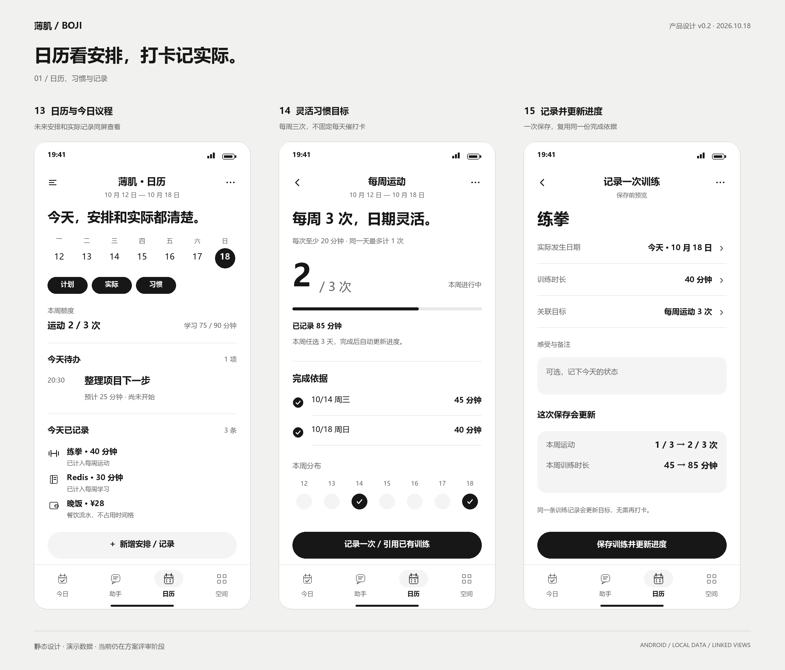
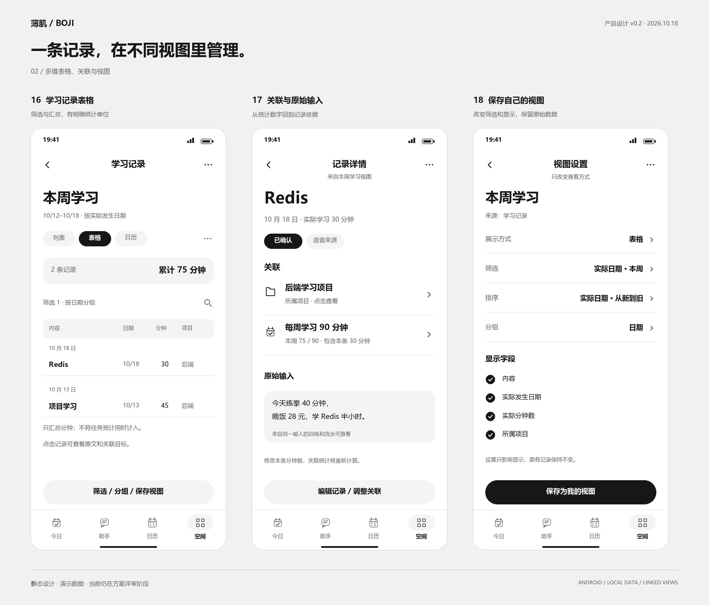
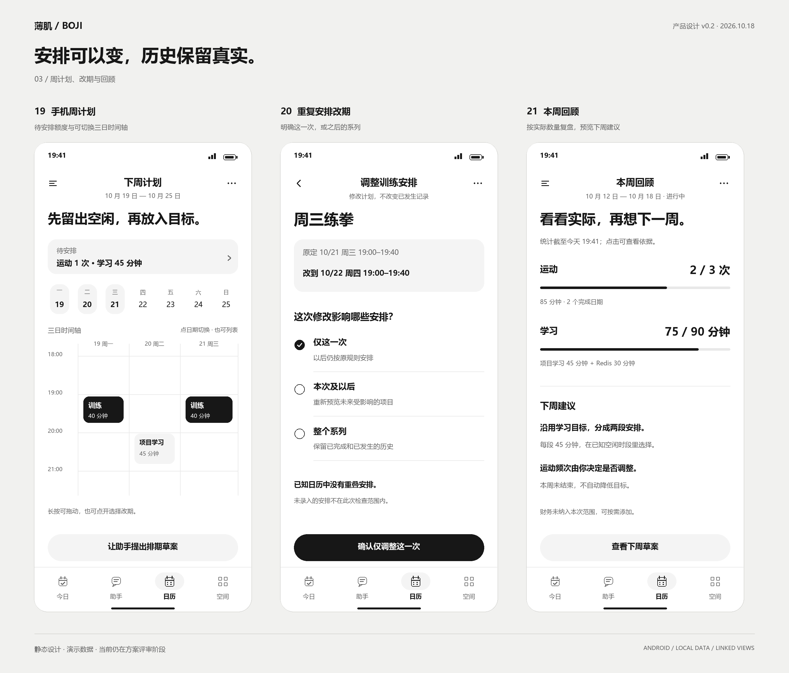

# 薄肌 · 产品设计深化 v0.2

2026-10-18。用户认可手机方案，要求继续研究日历、打卡、计划与多维表格的结合。**仍处于设计阶段，尚未授权应用开发。**

名称订正为「薄肌」，目录沿用现有 `boji`；本轮不改动工程或初始化应用。沿用 Android 优先、本地保存、按需云端 AI、黑白灰界面四项方向。

本轮将用户后半句按“引入飞书多维表格的管理方式”理解。推荐先在手机内实现对应产品机制；飞书账号连接、云端表格同步没有被视为已批准需求。

## 先看这份设计

- [深化方案](./calendar-habits-tables.md)：日历、计划、习惯的区别与联动；数据视图、关联记录、提醒、重复规则和分期范围。
- [交互与验收](./interaction-spec.md)：九张新增页面、统一示例数据、异常路径与后续验收。
- [调研记录](./research-sources.md)：飞书和滴答官方资料，以及研究结论的依据与边界。

## 九张新增原型

均为静态图，演示数据，不是可运行界面。本轮保留原版作为设计历史，新页面统一使用「薄肌」名称。

### 日历、习惯和实际记录

### 多维表格、关联与视图

### 周计划、重复规则和复盘

## 相对 v0.1 的具体变化

1. 目标增加固定日程、灵活频次、累计数量三种模式，打卡不再一律是勾选。
2. 日历补充待安排区与图层；无时刻的数据不占用时间格。
3. 打卡复用已关联的真实记录，补记保存实际日期与录入日期，不重复记账或计数。
4. 表格增加有类型的字段、保存视图、关联目标和来源；默认手机列表，表格用于整理。
5. 周计划明确固定事项、可用时段、缓冲和变更范围；重复计划可单次改期。
6. 新增具体统计口径和异常规则；健康、记账与习惯各自保留可信的事实数据。

## 评审建议

优先看第 13/14/15 页是否顺手，再看第 16/17/18 页的表格关系是否足够，最后评审周计划。无需现在确定复杂公式、外部同步和任意自动化。这些新机制仍是可讨论的建议，并未据此开始应用代码。
