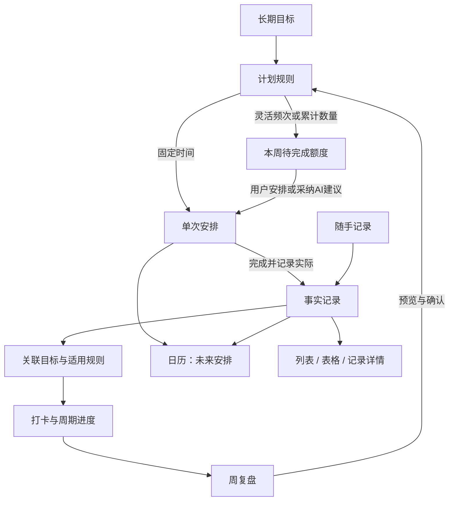

# 薄肌：日历、打卡、计划与多维数据空间

v0.2 · 2026-10-18 · 设计深化提案。

已确认：用户认可手机方向；Android 优先、本地数据、允许按需云端 AI。待评审：本轮具体交互、规则与分期。没有开始应用实现。

## 1. 这轮设计的中心

**让计划、实际记录和目标进度连起来，用户尽量只录一次。**

手机使用分成两种节奏：平时用今日、日历、语音和轻表单完成操作；整理时在数据空间筛选、关联和复盘。AI 可以贯穿两种节奏，帮忙整理和提出调整。

飞书多维表格最值得借鉴的是字段、记录关系与视图；滴答的参考价值是把重复、数量型打卡、单周期修改等规则交代清楚。官方证据见 [调研记录](./research-sources.md)。以下是基于研究给出的薄肌方案，不代表直接复制竞品功能。

## 2. 先把五个概念分清

| 概念 | 示例 | 作用 |
| --- | --- | --- |
| 长期目标 | 本月保持训练，完成后端小项目 | 关联一个方向和进展指标 |
| 计划规则 | 每周训练 3 次；每周一三五 19:00；每周学习 90 分钟 | 表达频率、额度和约束 |
| 单次安排 | 10/21 周三 19:00–19:40 练拳 | 占用具体时间，可以完成/改期/跳过 |
| 实际记录 | 10/18 实际练拳 40 分钟，附感受 | 保留发生的事实、原始输入和编辑历史 |
| 打卡进度 | 本周运动 2/3，学习 75/90 分钟 | 根据规则与关联事实汇总，必要时允许直接记录完成 |

日历里完成一个安排，与空间里新增实际记录，操作上可以一次完成。内部仍保留预计时段和实际时段，不能靠一列“已完成”覆盖所有含义。

## 3. 新建计划的三种主要模式

新建时用自然问题“你想怎么安排？”展示三项，使用例子解释，不先暴露复杂重复公式。

### A. 固定安排

“每周一、三、五 19:00 练拳，每次 40 分钟。”

- 规则生成对应的单次安排，未来日历能看到。
- 一次未完成只影响本次，不把下一次日期拖后。
- 完成时可记录实际时长；计划 40 分钟、实际 25 分钟，两者都保留。
- 重复提醒和重复任务是两个设置：任务每周三，不代表一定需要三次通知。

### B. 灵活频次

“每周运动 3 次，哪天都行。”

- 首页显示本周 2/3；未选择日期的次数出现在周计划的“待安排”。
- 不在周一到周日各生成一项未完成任务，也不每天提醒“逾期”。
- 用户可以把其中一次放进日历，完成后同时扣减本周剩余额度。
- 同一目标、同一事实不会因从日历和习惯页各点一次而计两次。
- 默认按不同自然日计运动次数，同日两段训练保留各自时长，次数仍计 1。用户创建时看得到这个口径。
- 可配置一次有效记录至少多少分钟，但阈值由用户明确设定；产品不把默认阈值当作训练健康建议。

### C. 累计数量

“每周学习 90 分钟。”

- 允许一天分多次累计，例如 20 + 10 分钟；记录 30/90，不强制当天全额达标。
- 统计以已确认且关联的实际记录为准；计时器运行 30 分钟但用户未确认结束，不直接变成事实。
- 超过目标显示实际量 110/90；用于进度条时可封顶 100%，明细不截断实际量。
- 次数、分钟、金额分别计算，不合成一个没有解释的“成长分数”。

“完成后再隔 N 天”作为后续高级规则保留设计，例如每完成一次后隔三天再提醒；不能把它误做为每周固定日程。农历、法定节假日和复杂间隔重复延后。

## 4. 打卡输入的三种方式

| 输入 | 适合场景 | 写入内容 |
| --- | --- | --- |
| 一键完成 | 整理账本、阅读完成等布尔行为 | 真实完成日期与完成声明；不捏造分钟/金额 |
| 输入数量 | 读书页数、学习分钟、训练时长 | 数量、单位、日期，可附备注 |
| 引用已有记录 | 已经记录过训练或学习 | 建立关联，复用同一事实，不复制业务记录 |

示例：用户保存“练拳 40 分钟”，且已经明确关联“每周运动 3 次”。一次保存可更新训练记录、当天实际记录、本周运动进度和训练目标明细。

关联明确时应用规则即可，不再要求另打卡。AI 只猜到记录可能属于某目标时，先展示建议关联，由用户核对；不能静默把“散步”当作已完成指定练拳计划。

### 同一件事如何避免重复

- 既有记录再关联习惯，只建立关系。
- 对已完成安排再次点击，进入查看/编辑实际记录，不追加一次完成。
- 多条来源可能是同一次活动，例如手动记录与后续健康导入：提示疑似重复，合并前核对；当前首版并不承诺健康导入。
- 一条记录能为两个不同目标提供依据，例如项目学习也属于每周学习；各目标独立汇总，全局学习时长按事实 ID 去重。
- 对时长型目标可选择“按记录累计”，或将同一活动标为重复/合并；没有可靠起止时刻时，不能自动推断两个学习时段重叠。

## 5. 补记、部分完成、跳过与暂停

| 动作 | 预期行为 | 不应该发生的事 |
| --- | --- | --- |
| 补记昨天 | 实际发生日期记昨天，今天保留录入时间与“补记”标识 | 给今天也增加一次完成 |
| 只做了 20/40 分钟 | 保留 20 分钟；安排可标“部分完成” | 抹去努力，或自动声称已完成 40 分钟 |
| 选择结束本次安排 | 结束这个时间块；数量型目标仍按实际量计算 | 因“结束”就把不足额度补满 |
| 跳过本次固定安排 | 保留“已跳过”，可填原因，不计完成 | 自动改成已完成，或无限累积红色逾期 |
| 改期 | 修改这一次的计划时间，事实不变 | 在原日期和新日期各算一次 |
| 暂停习惯 | 明确暂停起止，从后续周期起不再要求；不重写已有历史 | 已经发生的记录被删除或计为新失败 |
| 归档目标 | 从活跃视图隐藏，历史仍可查 | 把关联训练/流水一并删除 |

固定安排的到期状态和周期额度完成情况分别展示。临时跳过固定安排仍纳入原计划分母，并单独显示跳过数；取消且未发生的安排可从后续计划量移除。灵活周目标不支持用“跳过一次”偷偷降低分母，调整额度需展示“修改本周目标”并记录变更。

周期未结束显示“进行中”；周期结束未达标显示“本周完成 2/3”。本周完成率、当前连续周期、历史最佳等口径分开。首版主显示周期进度和近四周趋势，连续天数作为可选项，不做断签惩罚。

## 6. 日历的完整结构

### 月：看分布

月历展示每日计划完成提示和活动数量，不把所有标题挤进日期格。选日期后看下方议程；长按或“新增安排”打开表单。月历热度、训练次数和任务完成比需要说明各自口径，不能只给一个无说明深浅色。

### 日：做今天的事

顶部周日期条方便切日，下面分区：

1. 待安排/无具体时刻：当天未排时刻的任务、周额度入口。
2. 有时间的安排：显示计划区间与状态，支持开始、改期、跳过。
3. 实际记录：显示训练、学习、消费；已关联安排的事实合并展示并可展开预计/实际差异。

消费只有日期时放“当日流水”，不占据半小时工作时段；某一天有还款提醒，则提醒是安排，支付完成仍需要交易事实。

### 周：安排下一周

手机默认“周汇总 + 可切换的三日时间轴”，也提供按天议程列表；不把七个极窄列当成唯一交互。视野外日期可通过日期条切换，跨日移动另有点选日期/时间入口。七列周视图可留给横屏或更宽设备。

顶部“待安排”显示剩余周额度与没有日期的下一步；用户点“安排”即可选择时段。长按拖动是可选快捷方式，菜单改期必须始终可用。

图层建议保留三个：**计划、实际、习惯**。默认计划与实际开启，习惯显示为每日/每周汇总而非每次提醒一个事件。财务事实按用户筛选显示；锁屏通知不显示金额等敏感内容。

今日的“待办完成率”按当天单次安排算；周习惯按各自周期算；二者不相加。草稿不进入事实统计。

## 7. 周计划与 AI 参与方式

周计划由四部分构成：固定事项、可用时段、目标剩余额度、缓冲。固定事项优先；目标只在用户允许的空闲时段里排，保留休息和机动。

AI 应能完成几类具体请求：

- “下周只在晚上安排，两次运动、两次项目学习。” → 先补问缺少的时段限制，再给可勾选草案。
- “把周三训练挪到周四，只改这一次。” → 展示原/新时间、与已知安排的冲突和修改范围。
- “建立一个只看本周学习的表格视图。” → 预览筛选、分组和显示字段；确认后保存视图，不复制所有记录。
- “我这个月训练花了多少？” → 只统计明确关联的训练支出，说明未关联流水不包含；不靠语义猜测全部支出。
- “本周为什么没完成？” → 展示完成量与用户记录的原因；可以提调整建议，不编造心理原因。

AI 不应任意修改过去的事实、改变已完成目标口径、批量跳过待办，或为美化完成率自动降低目标。所有这些行为必须明确展示并由用户决定。

首版提醒由本地规则负责，AI 可建议调整提醒。提醒分为：已排日程提醒、用户选择的习惯提醒、可关闭的周末回顾。灵活频次默认不每天催，主动提醒需用户开启；聚合通知并设静默时段。精确送达仍需后续 Android 实机验证。

## 8. 引入多维表格的六个机制

| 机制 | 薄肌中的产品表现 | 首版范围 |
| --- | --- | --- |
| 字段类型 | 日期、时长/金额/次数、单选状态、标签、备注、附件、关联目标 | 核心字段固定，部分领域可选字段可显示/隐藏 |
| 保存视图 | 我的训练、本周学习、餐饮流水、待安排、待整理 | 内置视图 + 基础保存筛选/排序/列显示 |
| 分组与汇总 | 按周、目标、类别查看分钟、次数或人民币金额 | 一层分组，确定性汇总，不跨单位求和 |
| 关联记录 | 训练 ↔ 目标；学习 ↔ 项目；消费 ↔ 训练目标 | 点开关联即可查看详情与来源 |
| 表单录入 | 一笔消费、一次训练、一次学习快速表单 | 字段随领域变化，保留常用值；金额不凭历史自动复用 |
| 看板 | 学习项目按待办/进行中/完成整理 | 后续增强；完成列仍受实际记录要求约束 |

空值表示未知，零值表示确定为零。金额/时长只在对应领域显示，汇总必须显示统计范围、单位和过滤条件。

首版不开放任意公式、脚本、插件、企业权限和自建任意表结构；用户自定义字段/自由建表可做第二阶段扩展，新增字段不能绕开内置金额与完成规则。这让多维表格提升整理能力，不迫使用户先学习如何搭系统。

### 数据表如何组织

用户可见的逻辑集合：目标与项目、计划、训练记录、收支流水、学习记录与想法。目标和项目默认提供模板，按需要启用。

跨领域“全部记录”是只展示通用字段的汇总视图。进入训练集合看组次/回合，进入流水集合看金额/账户；不能因为统一视图就把所有领域挤入一张几十列空值的表。

保存视图表达“在某个集合里，以什么条件和方式看数据”。数据不归视图所有：删除视图只删配置，记录仍在；在任一视图改记录，其他视图重新计算。筛选后新建的记录不符合当前筛选时，保存成功后提示“已保存，当前筛选下不可见”，提供查看入口。

### 最小字段关系

| 对象 | 必须保留的语义 | 备注 |
| --- | --- | --- |
| 目标/项目 | 名称、领域、指标单位、期限、状态 | 多指标分别展示，避免单一百分比误导 |
| 计划规则 | 模式、频次/目标量、周期起点、时区、开始/结束、有效版本 | 固定周期与灵活额度分别计算 |
| 单次安排 | 规则来源、原始周期标识、计划起止、当前状态 | 单次改期保留原始身份，不重建重复项 |
| 事实记录 | 实际日期/时刻、录入时刻、来源、量与单位、确认状态 | 各领域有独立明细 |
| 关联 | 事实、目标、安排、计量口径与有效状态 | 复用记录，统计去重 |
| 视图 | 数据集合、过滤、排序、分组、可见字段、展示方式 | 不存另一份业务记录 |

这是概念设计，不是数据库建表或迁移许可。旧提案的实体可以演进到这些语义，最终物理表结构留待开发前审查。

## 9. 三个领域如何真正关联

例如创建目标“持续练拳”：

- 训练：本周 2/3 次、共 85 分钟，点开是两条事实记录。
- 日程：下周计划两次 40 分钟，仍为未来安排。
- 消费：有明确关联的团课 ¥120、交通 ¥30，显示已记录支出 ¥150；未关联消费不擅自归入。
- 学习：可以关联一篇训练笔记，但阅读笔记不能充当训练次数。

这种关联帮助做计划和复盘，并不把用户生活全部塞入同一个完成评分。

财务领域的“每周检查账本”可以一键完成；“存下 500 元”只有明确的账户、实际记录与目标口径才能展示已达成。账户间转账、支出、储蓄目标不同，不能点卡就制造资金变化。

## 10. 周期、时区与改规则

- 第一版默认周一到周日、设备首次选择的时区（当前示例为 Asia/Shanghai），周期边界显示可查。后续切换时区先提示对未来提醒的影响，不重标过去完成日期。
- 记录保留实际发生日期与录入时间；只知道日期时不伪造具体时刻。
- 固定重复实例按“规则 + 原始周期位置”识别。改期后仍是同一项，避免再次展开时重复生成。
- 未来按可视窗口展开、持久化已编辑或完成实例即可；不需要提前制造无穷多任务。离线跨周/重启必须恢复正确状态。
- 修改重复安排时分为仅本次、本次及之后、整个系列（不含已完成历史）。具体受影响范围必须写清楚。
- 改本周习惯额度属于明确操作，要展示变更前后分母；改“以后每周”不重算过去几周的达标状态。
- 每月 31 日的高级重复规则须明确短月处理（跳过或落月底），首版可不提供此选项，不能悄悄选一种。
- 归档/暂停规则不删除已发生事实。删除整组对象时先展示关联影响，避免级联抹掉流水和训练。

## 11. 分期建议与投入变化

本轮是把前版含糊的规则补全，并提出少量增强，未默认批准全量实现。

| 优先级 | 本轮建议纳入 | 理由 |
| --- | --- | --- |
| 基础必要 | 三种计划模式、实际数量打卡、已有记录关联、日/月历与待安排、单次改期、补记与归档 | 不解决会让数据和日常体验失真 |
| 基础必要 | 内置领域集合、通用记录汇总、关联目标、筛选与列显示、准确单位汇总 | 让多维形式服务真实操作 |
| 后续增强 | 保存自定义视图、周三日时间轴、跨周期系列修改、周复盘图 | 完成本地闭环后按试用价值优先做 |
| 后续扩展 | 任意自定义字段/建表、看板、完成后间隔重复、外部日历或飞书同步 | 有需求证据再增加复杂度 |

原版 28–46 个有效开发日的粗估不能直接涵盖本轮全部增强。核心规则需要进入原有工作量重新拆解；具体追加量在确定首版条目、目标手机和技术栈之后评估，本轮不伪报新工期。

## 12. 要用原型验证的四件事

1. 用户能否理解“每周三次”无需每天打卡，也能一眼发现本周还差多少。
2. 已经保存训练后，是否自然理解它已更新习惯进度，无需再点一次卡。
3. 是否能从目标点到关联记录、从记录返回目标，找到统计依据。
4. 不看说明，能否完成一次改期、补记，以及筛选“本周学习记录”。

先以这些任务做评审，不以页面数量或功能数量衡量方案好坏。
